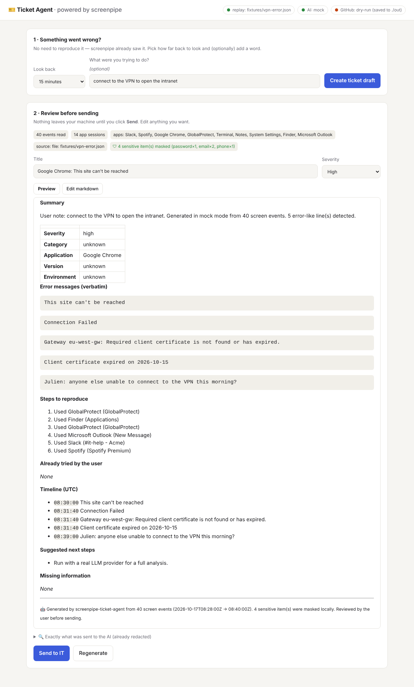
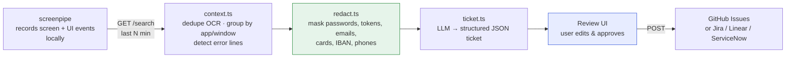

# 🎫 screenpipe Ticket Agent

**Turn what your computer already saw into a precise, ready-to-send IT ticket.**

> _"VPN doesn't work, thanks"_ → IT replies _"Which error? Which version? Can you send a screenshot?"_ → the user has to reproduce the bug… which may not happen again.

With screenpipe, the bug **has already been recorded**. One click and the agent reads the last minutes of screen activity, keeps what matters, masks secrets locally, and writes the ticket an IT technician actually wants: exact error messages, steps, app version, OS, what the user already tried, and a timeline.

Track: **Make it work for a team** (and a bit of _find what to automate_: every vague ticket is a support loop we remove).

<!-- TODO: replace with your demo GIF / video link -->


---

## Before / after

| What IT gets today | What IT gets with Ticket Agent |
|---|---|
| **Subject:** VPN marche pas<br>"le VPN ne marche plus depuis ce matin, je ne peux pas accéder à l'intranet. Merci" | **GlobalProtect: client certificate expired — cannot connect to eu-west-gw**<br>• Error (verbatim): `Required client certificate is not found or has expired.` / `Client certificate expired on 2026-10-15`<br>• GlobalProtect 6.2.1-87 · macOS Sequoia 15.4.1 · MacBook Pro M3 Pro<br>• Already tried: retry ×2, quit & relaunch the app; gateway reachable (ping OK, 0% loss)<br>• Suggested: renew/re-issue the user's client certificate |

_(Fictional example — try it yourself with `bun run demo`.)_

## How it works



1. **Collect** — calls screenpipe's local REST API (`/search`) for OCR text and UI events over the last _N_ minutes.
2. **Clean** — OCR repeats the same text every frame: we dedupe lines per app/window, build a chronological timeline of "app sessions", flag lines that look like errors (EN + FR), and fit everything into a token budget (most recent first).
3. **Redact** — secrets and personal data are masked **on the machine, before any LLM call**: passwords, API keys, JWT/Bearer tokens, private keys, emails, phone numbers, IBANs, card numbers (Luhn-checked).
4. **Generate** — the LLM gets a strict prompt: only facts present in the context, error messages copied verbatim, unknowns listed as "missing info" instead of invented.
5. **Review** — the user sees the ticket **and exactly what was sent to the AI**, edits it, and decides to send. Nothing is published without that click.
6. **Publish** — creates a GitHub issue with labels (`it-ticket`, `severity:*`). No token? Dry-run mode saves it to `./out/`.

## Quick start

Requirements: [Bun](https://bun.sh) ≥ 1.2.3, [screenpipe](https://docs.screenpi.pe) running.

```bash
git clone <this-repo> && cd screenpipe-ticket-agent
bun install
cp .env.example .env
```

### Try it in 10 seconds (no screenpipe, no API key)

```bash
bun run demo          # → http://127.0.0.1:4242
```

Replays `fixtures/vpn-error.json` (a recorded VPN failure). Without an LLM key it uses a deterministic mock; add `ANTHROPIC_API_KEY` to `.env` for the real ticket.

### Run it for real

```bash
# 1. start screenpipe (grant screen-recording + accessibility permissions on macOS)
npx screenpipe@latest record

# 2. check it's recording and get the API key
curl http://localhost:3030/health
screenpipe auth token        # → put it in SCREENPIPE_API_KEY

# 3. fill .env: SCREENPIPE_API_KEY, ANTHROPIC_API_KEY (or OPENAI_API_KEY), GITHUB_TOKEN, GITHUB_REPO
bun run dev                  # → http://127.0.0.1:4242
```

### CLI (bind it to a global keyboard shortcut)

```bash
bun run ticket                                   # draft from the last 15 min
bun run ticket -m 5 -n "can't open the intranet" # 5 min + a note
bun run ticket --show-context                    # also print what is sent to the LLM
bun run ticket --publish                         # draft + create the GitHub issue
bun run ticket --demo                            # on the bundled fixture
```

### Record a fixture (demo safety net)

```bash
bun run snapshot 10                              # save the last 10 min of screenpipe data
CONTEXT_FILE=fixtures/snapshot-<date>.json bun run dev
```

## Configuration

| Variable | Default | |
|---|---|---|
| `SCREENPIPE_URL` | `http://localhost:3030` | screenpipe API |
| `SCREENPIPE_API_KEY` | – | `screenpipe auth token` |
| `CONTENT_TYPES` | `ocr,ui` | add `audio` to include transcripts |
| `LOOKBACK_MINUTES` | `15` | default window |
| `MAX_CONTEXT_CHARS` | `12000` | context budget sent to the LLM |
| `CONTEXT_FILE` | – | replay a saved response instead of calling screenpipe |
| `LLM_PROVIDER` | `anthropic` | `anthropic` · `openai` (any OpenAI-compatible endpoint: Mistral, Ollama…) · `mock` |
| `TICKET_LANGUAGE` | `en` | e.g. `fr` |
| `GITHUB_TOKEN` / `GITHUB_REPO` | – | fine-grained token with *Issues: read & write* · `owner/repo`. Empty = dry-run |

## Privacy by design

- The server listens on **127.0.0.1 only**. Screen data never leaves the machine except the redacted context sent to the LLM, and the ticket the user explicitly approves.
- Redaction happens **before** the LLM call, and again on the generated ticket.
- The review screen shows **the exact text sent to the AI** — no black box.
- Swap `LLM_PROVIDER=openai` + `OPENAI_BASE_URL=http://localhost:11434/v1` to run fully local with Ollama.

## Project structure

```
src/
  config.ts     env config
  context.ts    screenpipe /search → deduped timeline + error highlights
  redact.ts     local masking of secrets & personal data
  ticket.ts     prompt, LLM providers (Anthropic / OpenAI-compatible / mock), JSON parsing, markdown
  publish.ts    GitHub Issues (+ dry-run). Add Jira / Linear / ServiceNow here
  pipeline.ts   fetch → clean → redact → LLM → markdown
  server.ts     local web app + API (/api/status, /api/draft, /api/publish)
  cli.ts        terminal version
public/index.html   review UI
scripts/snapshot.ts save live screenpipe data as a fixture
fixtures/           demo data (fictional)
```

## Roadmap

- **Duplicate detection** — before creating a ticket, search open issues for the same error ("12 users hit this certificate error today" → one incident instead of 12 tickets).
- **Self-service fix first** — match the error against a knowledge base and suggest the fix before escalating.
- **IT dashboard** — aggregate tickets by app/error to spot failing tools across the team.
- **Connectors** — Jira Service Management, ServiceNow, Linear, Zendesk.
- **Native trigger** — package as a screenpipe pipe + global hotkey / menu-bar button.
- **Screenshot attachment** — attach the redacted frame of the error (screenpipe frames API).
- **Smarter windowing** — auto-detect when the problem started instead of a fixed look-back.

## Team

<!-- names / 42 logins -->

Built at the screenpipe hackathon, October 2026.
